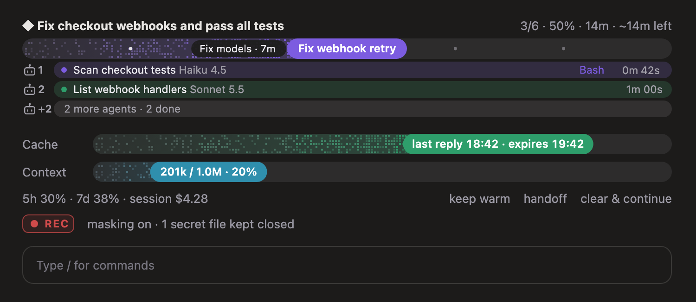

# pappu-claude-mods

Four small mods that make Claude Code easier to live in: see your prompt cache and context at a glance, hide secrets while you record, watch a `/goal` fill up task by task, and stop two chats from editing the same file.



| Mod | What it does | Commands |
|---|---|---|
| **cache-meter** | Cache and context tracks above the prompt. Warns 5 minutes before the prompt cache goes cold, can keep it warm while you're away, and hands a long chat off to a fresh one in two clicks. | `/cachemeter`, `/keepwarm [hours\|off]` |
| **screen-guard** | Turn it on before you record or share your screen. Emails, API keys, tokens, money and phone numbers are masked on screen in every open chat, and secret files (`.env`, keys, credentials) stay closed. Claude still works with the real values. | `/rec`, `/rec strict`, `/rec off` |
| **goal-tracker** | A live progress track for `/goal`: a dot per task (hover one for how long it took), the current task riding the pill (hover it for a live clock), an ETA, and a strip for each subagent at work. | `/goal-tracker hide\|show\|clear` |
| **edit-guard** | Before Claude edits a file that another open chat changed in the last 30 minutes, it asks: go ahead, use a worktree, or skip. | `/editguard [on\|off\|window N]` |

## Install

Needs Claude Code 2.1.287 or newer (`claude --version`, `claude update`).

In a terminal Claude Code session, install the ones you want:

```
/plugin install cache-meter --marketplace pappusinghadip/pappu-claude-mods
/plugin install screen-guard --marketplace pappusinghadip/pappu-claude-mods
/plugin install goal-tracker --marketplace pappusinghadip/pappu-claude-mods
/plugin install edit-guard --marketplace pappusinghadip/pappu-claude-mods
```

Answer `y` to add the marketplace, then pick the user scope. Or from your shell:

```bash
claude plugin marketplace add pappusinghadip/pappu-claude-mods
claude plugin install cache-meter@pappu-mods
```

Installed mods also load in the desktop app's Code tab. Open a new chat after installing.

## How each one works

### cache-meter
- **Cache track**: empties as the cache cools. Green while warm, amber in the last 5 minutes, red once cold, blue while kept warm. Hover the pill for when the last reply landed and when the cache expires.
- **Context track**: how full the chat is; amber past 70%, red past 90%. Hover the pill for the token counts.
- **keep warm** / `/keepwarm 2`: shortly before the cache would expire, it sends a tiny "ok" request that reads the cached chat, so your next message stays cheap. It stops by itself if a ping misses the cache.
- **handoff**: asks Claude for a handoff summary. **clear & continue** then clears the chat and starts the fresh one from that summary.
- The cache window defaults to 60 minutes. On a 5-minute cache, run `/cachemeter ttl 5`.

### screen-guard
- `/rec` in any chat turns it on in every open chat (the switch is a file under `~/.claude/mods-data/`). A red **REC** chip shows above the prompt.
- Masking is pattern-based: it catches common formats, not every possible secret. Other windows on your screen are not covered.
- `/rec strict` also hides every number of 4+ digits and every percentage.

### goal-tracker
- Starts when you run `/goal <what done looks like>`, and fills as Claude's task list moves (TaskCreate / TaskUpdate / TodoWrite).
- The ETA appears once two tasks are done, at the pace so far.
- Subagents started during the goal get a strip: number, name, model, current tool and a live timer. Up to three show; the rest fold into one "+N more" strip.
- The terminal shows a simple text bar instead of the drawn track.

### edit-guard
- Each chat writes the files it edited to `~/.claude/mods-data/edit-guard/<chat>.json`; the others check it before an edit.
- Only chats with edit-guard installed are seen.

## Privacy

Everything stays on your machine. The mods make no network calls of their own; the only model requests are cache-meter's keep-warm pings, and only while you turn keep-warm on. Data lives under `~/.claude/mods-data/`.

## Develop

Each mod is a plugin under `plugins/<name>/` with a TypeScript hooks module in `hooks/register.tsx`, pure logic in `hooks/lib.ts`, and tests in `hooks/lib.test.ts`.

```bash
claude plugin validate plugins/cache-meter
claude plugin test plugins/cache-meter
claude --plugin-dir plugins/cache-meter
```

`shared/ui.ts` holds the bar drawing; a plugin can only import its own files, so run `scripts/sync.sh` after changing it.

## License

MIT
